# Black Relay — diagrams

Mermaid sources for how the site box, its modems and the hub connect and work.
They render on GitHub and in VS Code. Companion to
`../../cwwk/docs/Black-Relay-Site-Architecture.pdf` (rendered: `Black-Relay-Diagrams.pdf`) and `../../cwwk/controller/README.md`.

## 1. End to end: every modem, its own carrier, one hub

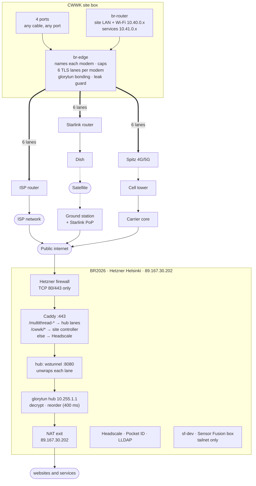

## 2. Inside the CWWK: one port bridge

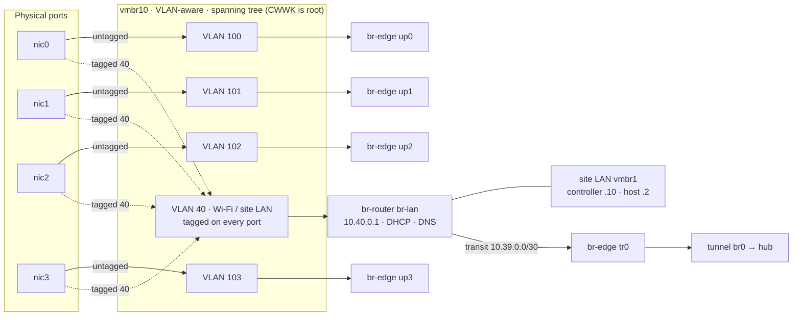

## 3. What each port becomes

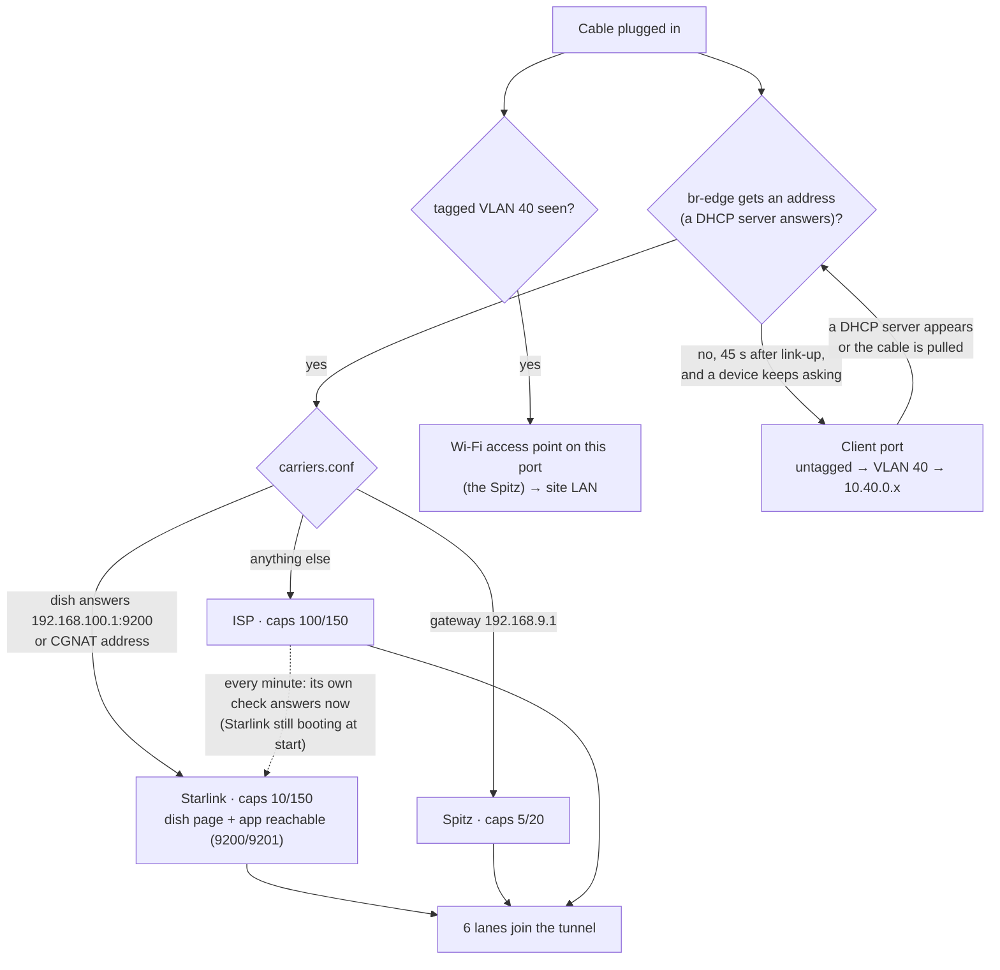

## 4. Packet pipeline: deconstruct, spread, reconstruct

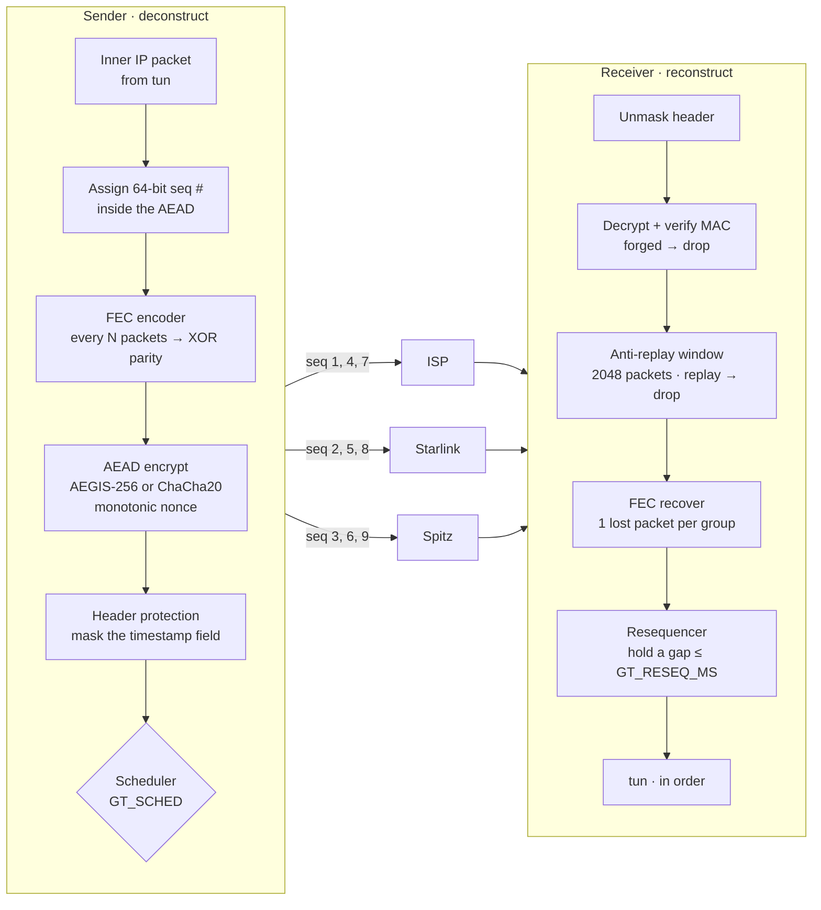

## 5. One group, end to end

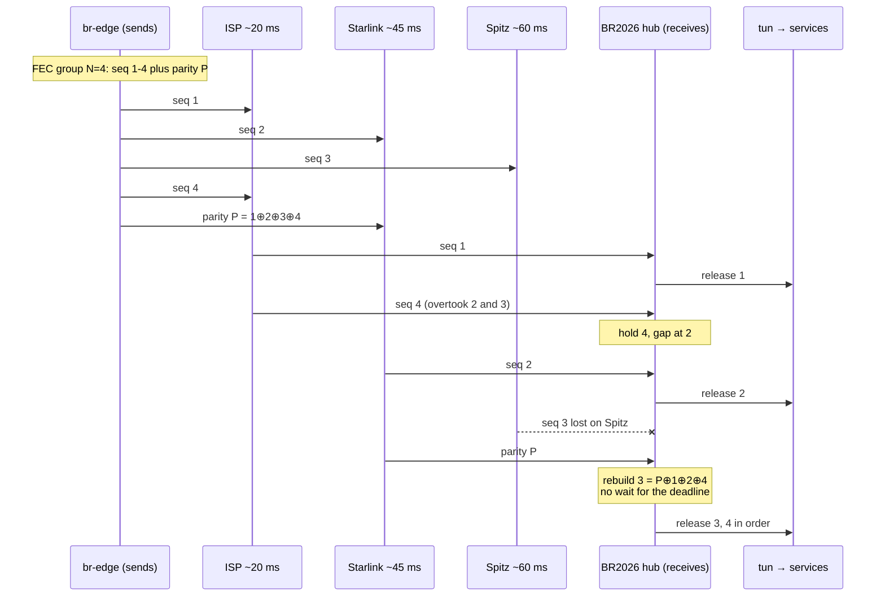

## 6. Resequencer decisions

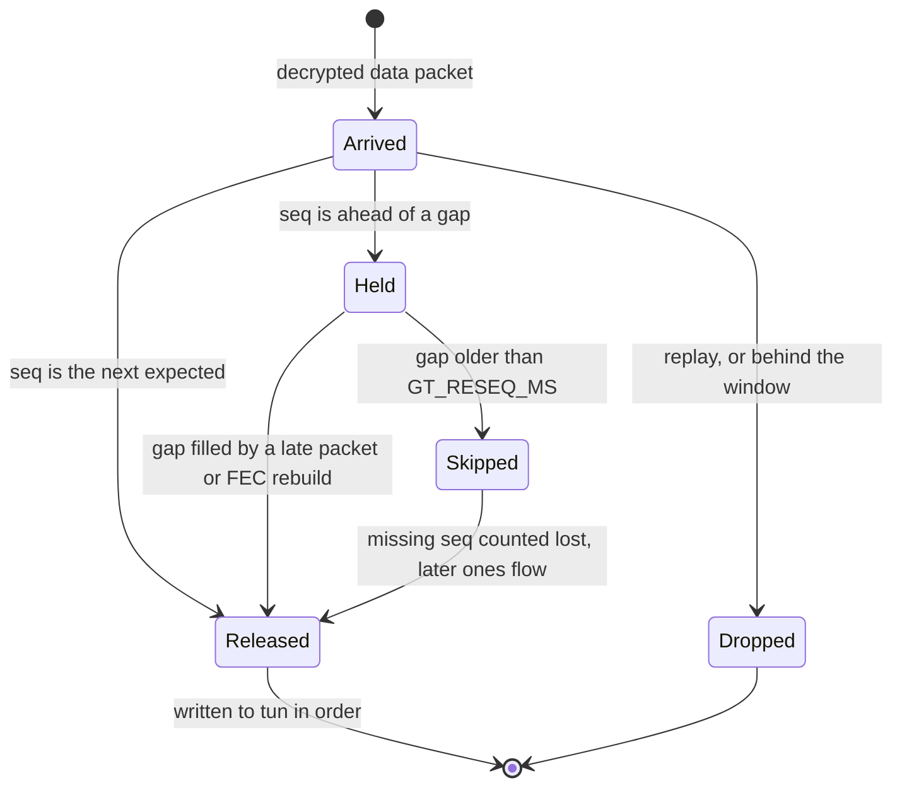

## 7. Adaptive FEC (GT_FEC=auto; off today, GT_FEC=0)

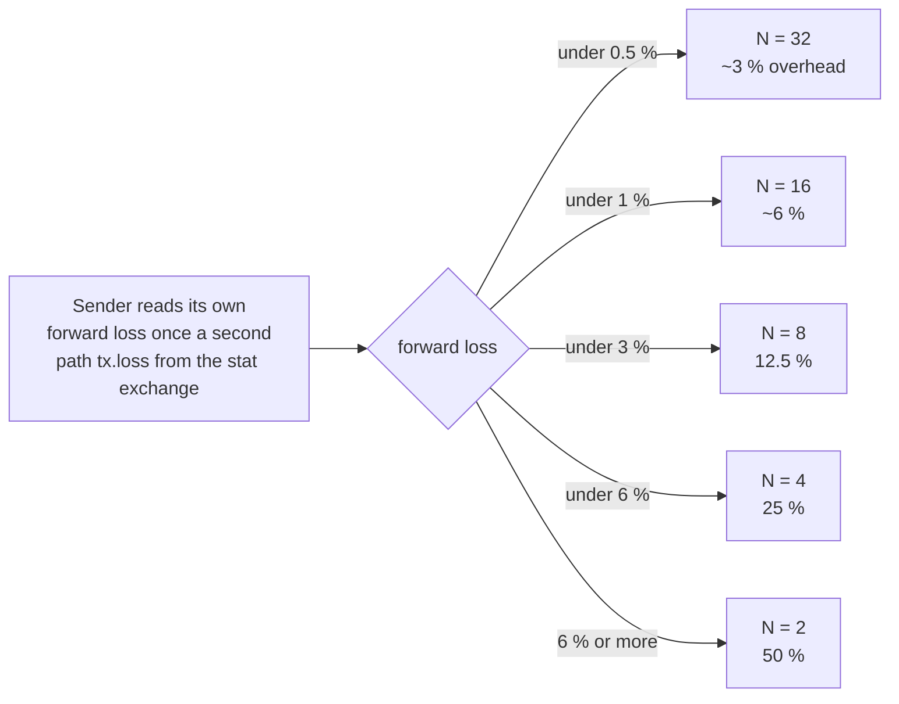

## 8. Self-healing

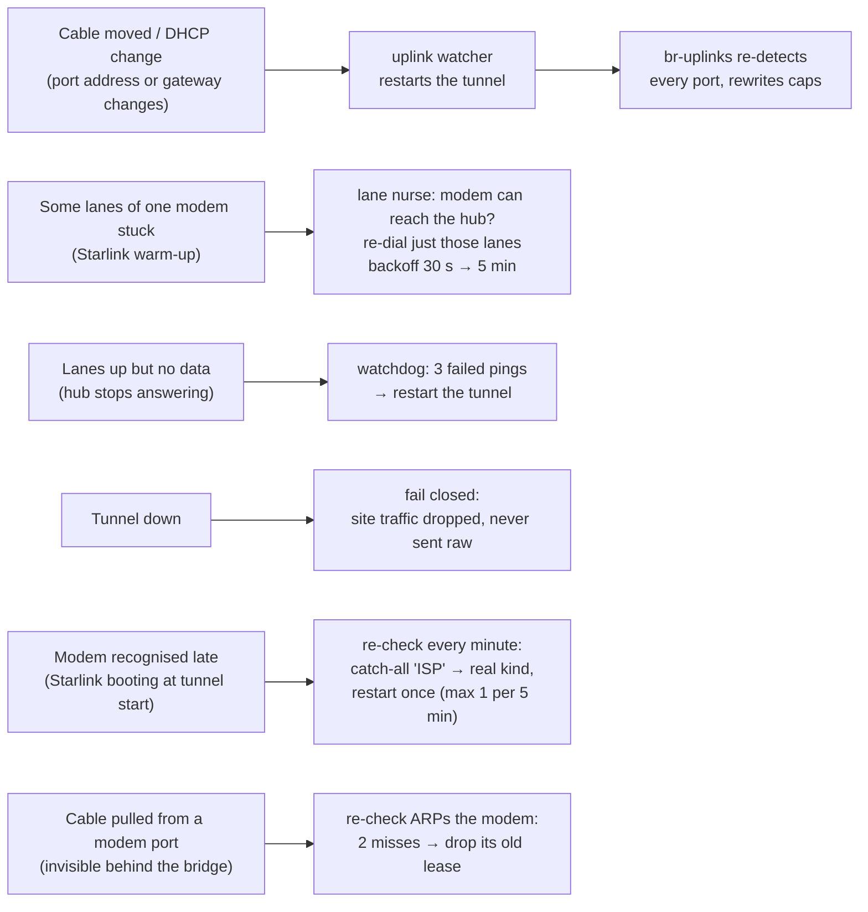

## 9. Remote access to the site controller

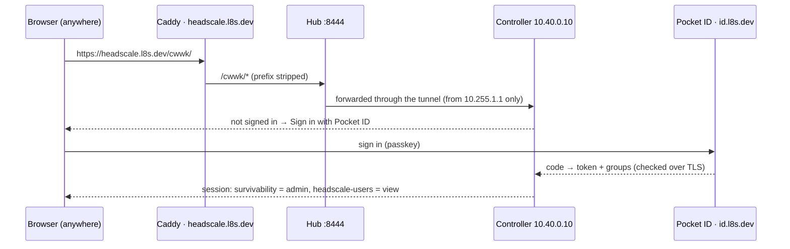

## 10. Many sites, one hub

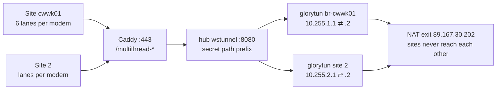

## 11. Site lock: power-on to unlocked

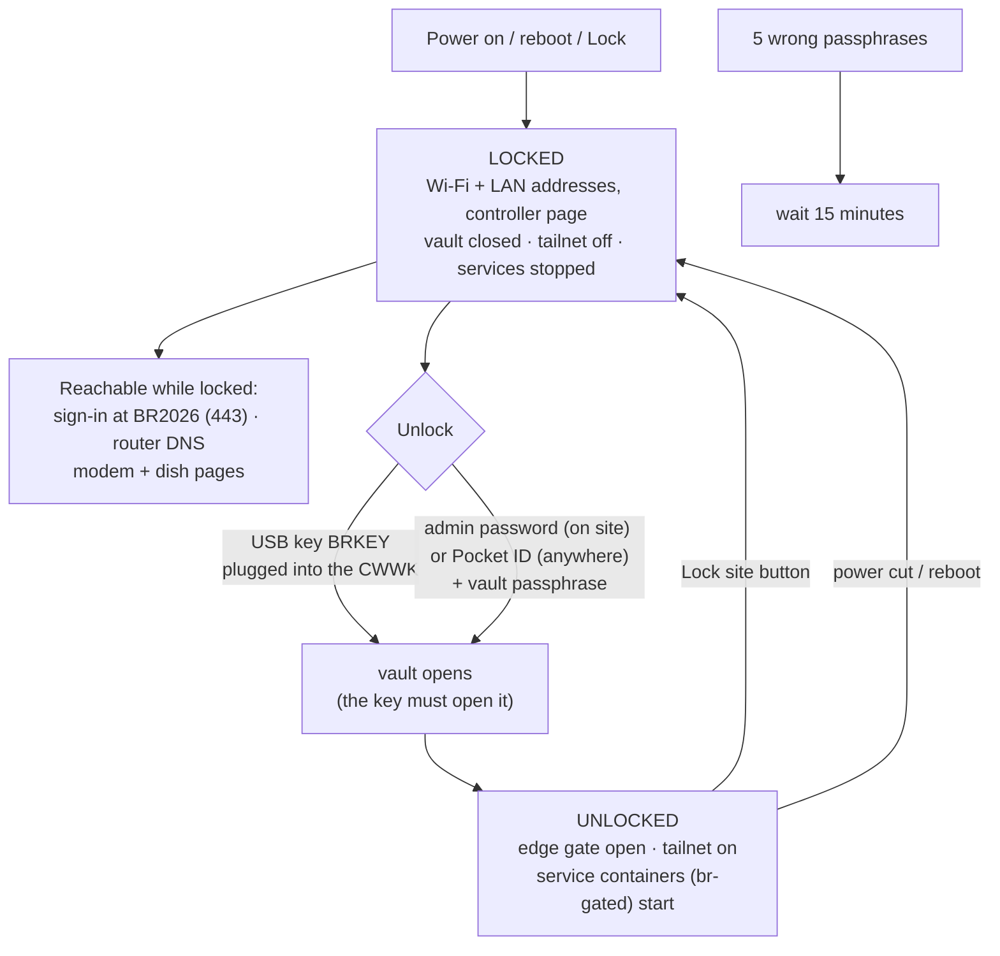

## 12. Sensor Fusion on BR2026

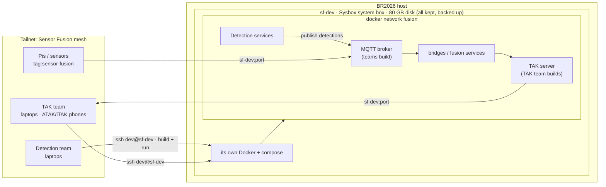

